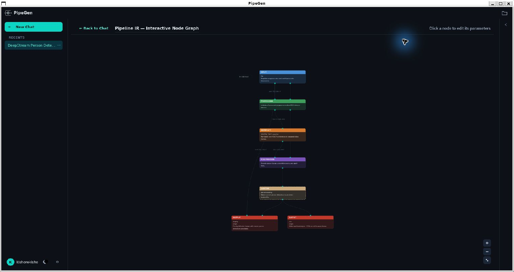

# GuardianEdge AI

**Hackathon project:** `CraftifAIHackathon_CRA004`
**Participant code:** `CRA004`
**Project homepage:** https://github.com/KishoreKavali0409/CraftifAIHackathon_CRA004

Explainable person-zone incident monitoring built with **CraftifAI PipeGen**, NVIDIA DeepStream and TensorRT.

GuardianEdge turns tracked person detections into structured intrusion, observed-exit and track-loss events. The real PipeGen workflow completed all five stages: **Requirement → Pipeline IR → Model → Compiler → Run**.


## How it works

```text
Video → DeepStream + YOLO11s TensorRT → Tracker → Frame metadata
      → PipeGen adapter → MVC zone analytics → Incident JSONL
```

- Configurable polygon zones use each person's bounding-box bottom-center.
- Three consecutive qualifying observations confirm entry; continued presence suppresses repeat alerts.
- An observed exit closes the incident; reentry creates a new incident ID.
- Missing or low-confidence tracks produce `TRACK_LOST`, rather than an assumed exit.
- The native overlay draws the same demonstration polygon used by the analytics.

## Choose how to run

| Goal | Follow this section | GPU required? |
|---|---|---|
| Run the complete video detection and incident workflow on the configured laptop | [Run the full project](#run-the-full-project-on-the-configured-laptop) | Yes |
| Try the incident analytics using saved real detections | [Replay real metadata](#replay-real-metadata-without-a-gpu) | No |
| Check application behavior | [Run the tests](#run-the-tests) | No |

The application uses terminal commands, JSON output and the DeepStream video display. There is no web server or browser dashboard to start.

## Project location and terminals

The main working project is inside **Ubuntu 22.04 / WSL2**:

```text
/home/kishore/craftifai/guardianedge-ai
```

To open the same folder in Windows File Explorer, paste this into its address bar:

```text
\\wsl.localhost\Ubuntu-22.04\home\kishore\craftifai\guardianedge-ai
```

Run the Linux commands below in **Ubuntu**, from the repository root. Open Ubuntu 22.04 from the Start menu. Alternatively, enter this command in PowerShell to open an Ubuntu shell:

```powershell
wsl -d Ubuntu-22.04
```

Then select the project:

```bash
cd ~/craftifai/guardianedge-ai
pwd
```

Expected location: `/home/kishore/craftifai/guardianedge-ai`.

For terminal paste, use **Ctrl+Shift+V** or right-click. Paste commands into the terminal, not the PipeGen requirement box. Run each command block in order.

## Run the full project on the configured laptop

### 1. Start Docker Desktop on Windows

Open Docker Desktop and wait until its engine is running. Use its existing Ubuntu WSL integration. The verified setup uses Ubuntu 22.04, PipeGen 0.5.1 and an NVIDIA MX550 with 2 GB VRAM.

In Ubuntu, check the connection and GPU:

```bash
docker info --format '{{.ServerVersion}}'
nvidia-smi
```

The first command should print the Docker server version. The second should show the NVIDIA GPU.

### 2. Start PipeGen in the first Ubuntu terminal

```bash
pipegen
```

Wait for the app to finish its startup checks and reach the main project screen. If it requests authentication, sign in inside the app. Keep PipeGen open. It manages the vendor DeepStream runtime used by this project.

Open a **second Ubuntu terminal** for the remaining commands. You do not need to regenerate the five PipeGen stages for each run; the generated pipeline and compiled engine already exist locally.

### 3. Check the runtime and local assets

In the second terminal:

```bash
cd ~/craftifai/guardianedge-ai
python3 --version
docker inspect -f '{{.State.Running}}' craftifai-amd64-v3
ls -lh media/sample_720p.mp4 pipegen-export/models/yolo11s.fp16.plan
```

Expected results:

- Python **3.10 or newer**.
- Container state **`true`**.
- Both the sample MP4 and TensorRT plan are listed.

The full local project contains these assets. They are excluded from Git, so a fresh clone does not contain them. See [reproduction and model assets](docs/reproduction.md) and the [original exported launcher guide](pipegen-export/README.md) when preparing another machine. TensorRT engines are GPU/runtime specific.

### 4. Run the default recorded demonstration

```bash
bash scripts/run_guardianedge.sh
```

The runner automatically:

1. Loads `config/pedestrian-demo.json` and installs its native polygon overlay.
2. Runs the real exported DeepStream detector and tracker on `media/sample_720p.mp4`.
3. Saves the annotated video and actual per-frame metadata.
4. Processes the completed metadata through the adapter and MVC incident analytics.
5. Prints the result directory when the run succeeds.

Default mode records a video without opening a live video window. The pipeline log is redirected to a file, so the terminal may remain quiet while inference runs. Wait for a message similar to:

```text
Completed real GPU run. Results: /home/kishore/craftifai/guardianedge-ai/work/run-YYYYMMDDTHHMMSSZ
Metadata: metadata.json; incidents: incidents.jsonl; runtime: pipeline.log
Annotated video: output.mp4
```

Incident analysis runs **after the video completes**. Avoid launching multiple GPU runs at the same time.

### 5. Open and inspect the results

From the repository root, select the most recently created run folder:

```bash
GE_RUN_DIR="$(ls -dt work/run-* | head -n 1)"
echo "$GE_RUN_DIR"
ls -lh "$GE_RUN_DIR"
```

| File | Contents |
|---|---|
| `output.mp4` | Recorded detections, tracker IDs and demonstration-zone overlay |
| `metadata.json` | Actual generated DeepStream frame/object metadata |
| `incidents.jsonl` | One structured incident event per line |
| `pipeline.log` | Native build and GPU pipeline diagnostics |

Open the result folder in Windows File Explorer:

```bash
explorer.exe "$(wslpath -w "$PWD/$GE_RUN_DIR")"
```

Open `output.mp4` in a video player. Inspect events and their count in Ubuntu:

```bash
head -n 3 "$GE_RUN_DIR/incidents.jsonl"
wc -l "$GE_RUN_DIR/incidents.jsonl"
tail -n 30 "$GE_RUN_DIR/pipeline.log"
```

A successful new inference run may produce different event counts because tracking and confidence can vary. The exact retained verification results appear below.

### 6. Optional: show live video

Pass the video path as the first argument and `--display` as the second:

```bash
bash scripts/run_guardianedge.sh "$PWD/media/sample_720p.mp4" --display
```

The DeepStream window shows detections and the configured zone. Wait for the input to finish normally. Display mode still saves metadata and incidents; the default recording mode is the one that produces `output.mp4`.

### 7. Optional: use your own video

Use an absolute Linux path that is accessible at the same path inside the existing PipeGen container. On this configured machine, keep the input under the mounted Linux home directory:

```bash
bash scripts/run_guardianedge.sh /home/kishore/videos/my-video.mp4
```

For live display:

```bash
bash scripts/run_guardianedge.sh /home/kishore/videos/my-video.mp4 --display
```

The zone uses normalized image coordinates. Review `config/pedestrian-demo.json` before using a different camera view. The runner uses that configuration for both the native overlay and incident analytics.

## Replay real metadata without a GPU

This path uses Python **3.10+** and the standard library. Docker, PipeGen, model binaries and video are not needed to analyze the retained metadata.

If the repository is already present:

```bash
cd ~/craftifai/guardianedge-ai
```

On another machine, clone it first:

```bash
git clone https://github.com/KishoreKavali0409/CraftifAIHackathon_CRA004.git
cd CraftifAIHackathon_CRA004
```

Run the adapter from the repository root:

```bash
mkdir -p work
python3 -m guardianedge.adapters.pipegen --input evidence/pipegen-metadata.json --config config/pedestrian-demo.json > work/replayed-incidents.jsonl
```

Expected diagnostic: **1,442 metadata frames processed**. Check the saved output:

```bash
wc -l work/replayed-incidents.jsonl
head -n 3 work/replayed-incidents.jsonl
```

Expected event count for this retained metadata: **140**. The completion diagnostic is written separately to stderr; stdout is redirected to the event file. Incident UUIDs are generated anew on every replay.

This command analyzes saved genuine detections; it does not start the detector. Event types are `RESTRICTED_ZONE_INTRUSION`, `ZONE_EXIT` and `TRACK_LOST`. Source timestamps represent relative video time, with an explicit `timestamp_basis`; an epoch date is not the capture date.

## Run the tests

### 1. Select the project and check Python

```bash
cd ~/craftifai/guardianedge-ai
python3 --version
```

### 2. Run the complete test suite

```bash
python3 -m unittest discover -s tests -v
```

Expected completion:

```text
Ran 32 tests in ...s

OK
```

All tests must report `ok`. `FAILED`, `ERROR`, a traceback or a nonzero exit code indicates a problem. No GPU is required for these tests.

### 3. Run a focused group when investigating a failure

```bash
python3 -m unittest discover -s tests -p 'test_zones.py' -v
python3 -m unittest discover -s tests -p 'test_pipegen_adapter.py' -v
```

The full suite covers polygon boundaries, confirmation, alert suppression, observed exit/reentry, track loss, camera/person isolation, malformed input, state atomicity, timestamp ordering/provenance, CLI behavior and real-schema adapter mapping. Tests use controlled fixtures; the GPU workflow above separately verifies inference integration.

Saved verification transcripts are in `evidence/unit-tests-ubuntu.txt` and `evidence/unit-tests-windows.txt`.

## Troubleshooting

| Message or symptom | What to do |
|---|---|
| Docker cannot connect | Start Docker Desktop and check its Ubuntu WSL integration, then retry `docker info`. |
| Container state is `false` or container is missing | Launch `pipegen`, wait for startup checks, keep the app open, then repeat the container check. |
| `Video not found` | Check the input path or use the default local sample. Pass Linux paths to the Ubuntu runner. |
| Full local export/model assets required | Use the existing complete local project or follow the model/export instructions in `docs/reproduction.md`. Git does not include the plan or ONNX binaries. |
| `No module named guardianedge` | Change into the repository root before running Python commands. |
| No video window | Default mode records a video. Use an explicit video argument followed by `--display` for live display. |
| Terminal is quiet during inference | Inspect the newest run's `pipeline.log` from another terminal; wait for the completion message. |
| Runner exits before producing incidents | Read that run's `pipeline.log`. Incidents are analyzed only after the GPU pipeline succeeds. |
| Replay output directory missing | Run `mkdir -p work` before redirecting output. |
| `1970` appears in an event timestamp | It represents relative source media PTS; inspect `source_pts_ns` and `timestamp_basis`. |

## Architecture

| Component | Responsibility |
|---|---|
| `guardianedge/models/` | Validation, polygon geometry and incident state |
| `guardianedge/controllers/` | Frame and stream orchestration |
| `guardianedge/views/` | Incident JSONL and diagnostics |
| `guardianedge/adapters/` | Actual PipeGen metadata schema mapping |
| `scripts/` | GPU runner and native overlay installer |
| `pipegen-export/` | Actual generated pipeline, parsers and configurations |
| `config/` | Normalized polygon and confirmation settings |
| `tests/` | Application and adapter tests |
| `evidence/` | Genuine outputs, screenshots, reports and test transcripts |

See [architecture](docs/architecture.md), [reproduction](docs/reproduction.md) and the [original export guide](pipegen-export/README.md).

## PipeGen Pipeline IR



## Verified results

| Measurement | Result |
|---|---|
| Final real video run | 1,442 frames; 13,754 object records |
| Derived events | 70 intrusion confirmations, 10 observed exits, 60 track losses |
| PipeGen engine benchmark | 18.539 ms/inference; approximately 54 FPS derived |
| Separate live display observation | 17.36 FPS with dropped frames |
| Final recording check | Complete MP4 decode without errors |

The engine benchmark and live display measure different scopes. The FP16-requested engine contains mixed FP16/FP32 layers. See [evidence and measurement details](evidence/README.md) for original reports and qualifications.

Generated vendor notices are retained. Model and sample-media use remains subject to the original terms.
