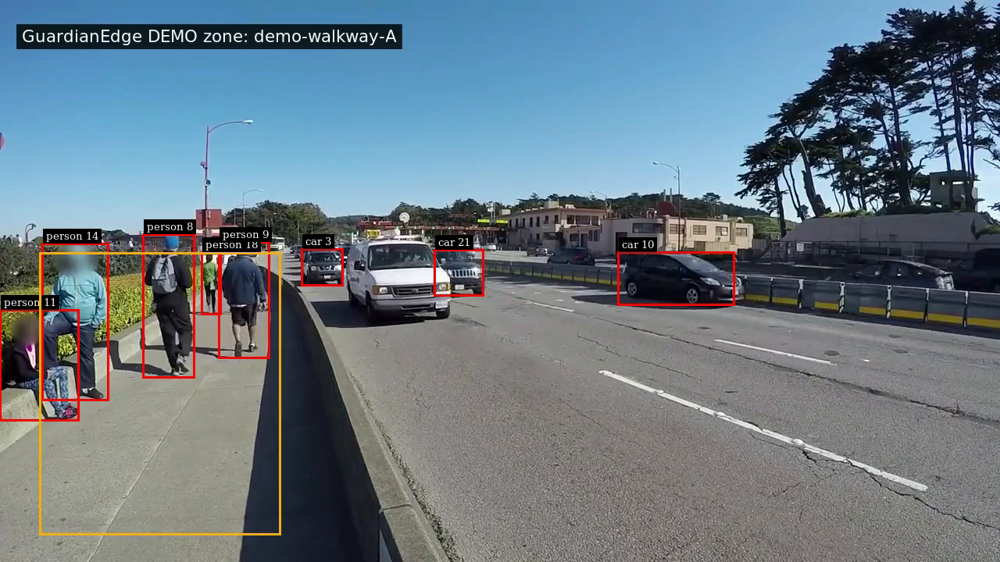

# GuardianEdge AI

Explainable person-zone incident monitoring built with **CraftifAI PipeGen**, NVIDIA DeepStream and TensorRT.

GuardianEdge turns tracked person detections into structured intrusion, observed-exit and track-loss events. The real PipeGen workflow completed all five stages: **Requirement → Pipeline IR → Model → Compiler → Run**.



## How it works

```text
Video → DeepStream + YOLO11s TensorRT → Tracker → Frame metadata
      → PipeGen adapter → MVC zone analytics → Incident JSONL
```

- Configurable polygon zones use each person's bounding-box bottom-center.
- Three consecutive qualifying observations confirm entry; continued presence suppresses repeat alerts.
- An observed exit closes the incident; reentry creates a new incident ID.
- Missing or low-confidence tracks produce `TRACK_LOST`, rather than an assumed exit.
- The native overlay draws the same demonstration polygon used by the analytics.

## Quick start: replay real metadata

This works without a GPU or model download. Requires **Python 3.10+**; the analytics uses only the standard library.

```bash
git clone https://github.com/KishoreKavali0409/guardianedge-ai.git
cd guardianedge-ai
mkdir -p work
python3 -m guardianedge.adapters.pipegen \
  --input evidence/pipegen-metadata.json \
  --config config/pedestrian-demo.json > work/incidents.jsonl
```

This analyzes retained genuine inference metadata; it does not run a detector. Replaying the retained sample produces **140 events**. Incident UUIDs are generated anew on each replay.

## Run GPU video inference

The verified setup is Ubuntu 22.04 under WSL2, Docker Desktop, PipeGen 0.5.1 and an NVIDIA MX550 with 2 GB VRAM. Keep Docker Desktop and PipeGen running. The runner requires the existing `craftifai-amd64-v3` container, source video and local TensorRT engine.

From the configured repository:

```bash
bash scripts/run_guardianedge.sh
```

The default video is `media/sample_720p.mp4`. To choose another input and enable live display:

```bash
bash scripts/run_guardianedge.sh /absolute/linux/path/video.mp4 --display
```

The input and repository must be accessible at the same paths inside the container. Default recording mode saves `output.mp4`, `metadata.json`, `pipeline.log` and `incidents.jsonl` in a new `work/run-...` directory. Incident analysis runs **after video completion**.

Model engines, ONNX files and video binaries are excluded from Git. See [reproduction and model assets](docs/reproduction.md) before running a fresh clone. Clean-machine standalone rebuilding has not been independently verified.

## Test

From the repository root:

```bash
python3 -m unittest discover -s tests -v
```

**32 tests passed on Windows and Ubuntu.** Tests cover geometry, confirmation, suppression, exit/reentry, track loss, state isolation, malformed input, ordering, timestamp provenance, CLI behavior and the actual PipeGen metadata adapter. Unit fixtures are separate from real inference evidence.

## Architecture

| Component | Responsibility |
|---|---|
| `guardianedge/models/` | Validation, polygon geometry and incident state |
| `guardianedge/controllers/` | Frame and stream orchestration |
| `guardianedge/views/` | Incident JSONL and diagnostics |
| `guardianedge/adapters/` | Actual PipeGen metadata schema mapping |
| `scripts/` | GPU runner and native overlay installer |
| `pipegen-export/` | Actual generated pipeline, parsers and configurations |
| `config/` | Normalized polygon and confirmation settings |
| `tests/` | Application and adapter tests |
| `evidence/` | Genuine outputs, screenshots, reports and test transcripts |

See [architecture](docs/architecture.md), [reproduction](docs/reproduction.md) and the [original export guide](pipegen-export/README.md).

## Verified results

| Measurement | Result |
|---|---|
| Final real video run | 1,442 frames; 13,754 object records |
| Derived events | 70 intrusion confirmations, 10 observed exits, 60 track losses |
| PipeGen engine benchmark | 18.539 ms/inference; approximately 54 FPS derived |
| Separate live display observation | 17.36 FPS with dropped frames |
| Final recording check | Complete MP4 decode without errors |

The engine benchmark and live display measure different scopes. The FP16-requested engine contains mixed FP16/FP32 layers. See [evidence and measurement details](evidence/README.md) for original reports and qualifications.

## Limitations

The sample is a public street video with an explicitly labelled **demonstration zone**, not a validated industrial deployment. Frequent track loss can fragment incidents; tracker IDs do not establish personal identity. No facial recognition, measured safety accuracy, INT8 optimization or actual Jetson deployment is claimed. Jetson comparisons in the vendor report are modelled predictions.

Event timestamps preserve relative source media PTS with `timestamp_basis=media_pts_epoch_not_capture_utc`. Their epoch date is **not the capture date**. Dwell time follows media PTS rather than processing speed.

Generated vendor notices are retained. Model and sample-media use remains subject to the original terms; no blanket license for vendor assets is asserted.
